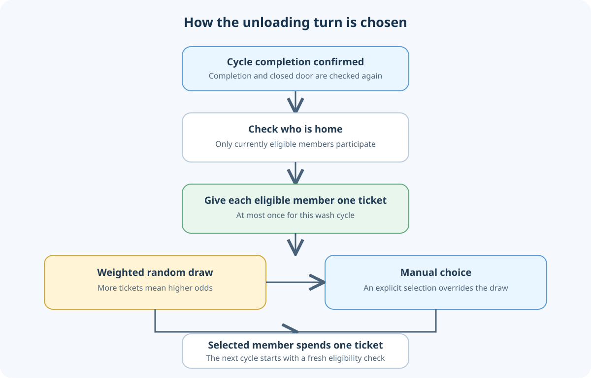
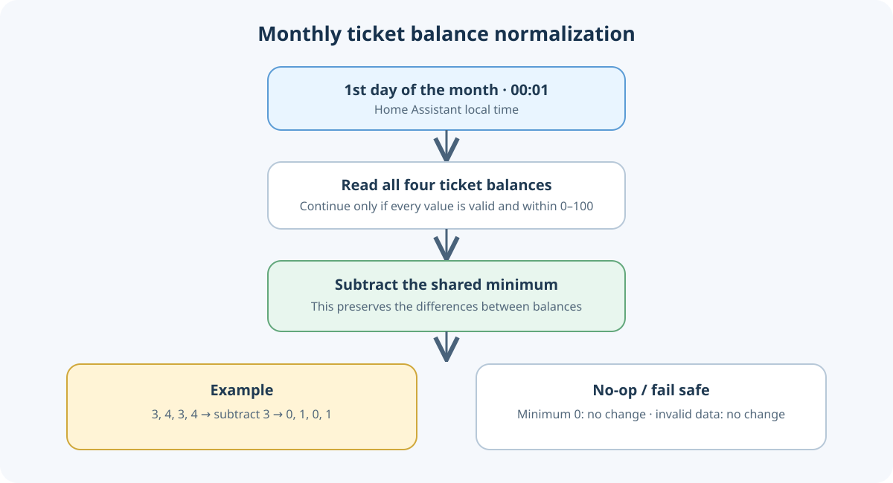

# Home Assistant Dishwasher Duty Lottery

A reusable Home Assistant YAML example for fairly assigning the dishwasher-unloading turn. Each household member who is home when a wash finishes receives one lottery ticket. The winner is drawn with odds proportional to their ticket balance, and one ticket is consumed for the selected winner. A manual selection can override the random draw.

## What is included

- `helpers.yaml` — ticket counters, cycle guard, manual-turn selector, and last-charged selector
- `script.yaml` — weighted random draw, ticket distribution, and ticket accounting
- `automations.yaml` — cycle reset, confirmed-completion draw, manual reassignment, and monthly ticket-balance normalization

The example does not start, stop, or control the dishwasher. It has no notifications or dashboard UI.

## At a glance





## How a cycle works

1. When the dishwasher enters `run`, the cycle guard and last-charged marker reset. The manual-turn selector returns to **Select a person**, so the next completed cycle is random unless someone is selected manually during the cycle.
2. Completion is accepted only when the configured completion, operation, abort, and closed-door states all match. The automation waits five seconds and checks them again.
3. Each currently home household member receives one ticket once for that cycle. A member who is away receives none.
4. The random draw weights each eligible member by their ticket balance, including the ticket just added. The winner loses one ticket. If a manual member is selected, that person wins instead, subject to the example's eligibility rules.
5. Changing the selected person after completion refunds the previous winner's ticket and charges the newly selected person.

If nobody is home, no ticket is distributed and no winner is selected. Ticket counters are capped at 100. Adjust that cap if your use case needs a different limit.

On the first day of each month at 00:01 Home Assistant local time, a separate automation subtracts the smallest of the four balances from every balance, but only when all four values are valid and within 0–100. For example, `3, 4, 3, 4` becomes `0, 1, 0, 1`. This keeps the relative ticket differences while preventing long-term counter growth. If the minimum is already zero, nothing changes; invalid or unavailable values fail closed. It does not award or consume tickets and does not control the appliance.

## Install as a Home Assistant package

1. Back up your Home Assistant configuration.
2. Ensure packages are enabled under `homeassistant:` in `configuration.yaml` (merge this into any existing `homeassistant:` section; do not create a duplicate):

   ```yaml
   homeassistant:
     packages: !include_dir_named packages
   ```

3. Create `packages/dishwasher_lottery.yaml`. Copy the `input_number`, `input_boolean`, and `input_select` sections from `helpers.yaml`, the `dishwasher_lottery_draw` entry from `script.yaml` under a `script:` key, and all entries from `automations.yaml` under an `automation:` key. A package combines these sections into one YAML file. Alternatively, merge the sections into your existing helper, script, and automation configuration.
4. Replace every example entity ID and state with values from your own Home Assistant instance (see below). Keep the helper IDs consistent across the files.
5. Run Home Assistant's configuration check. Review the automation traces after a real wash before relying on the assignment.

Do not paste this example into a live system without adapting and reviewing it first. The files are a template, not a drop-in configuration.

## Entities and states to adapt

Replace `person.household_member_1` through `person.household_member_4` with the household's Person entities in both the script and automation. Rename the four `Member` labels consistently if desired. The example has four members; changing the number requires updating the script's `rows` list and all matching selector options and action branches.

Map these dishwasher states to your integration. The values below are placeholders, not Home Assistant defaults:

| Example entity | Expected state in this example | Adapt it to |
| --- | --- | --- |
| `sensor.dishwasher_program_finished` | `present` | A reliable indication that the program has finished |
| `sensor.dishwasher_operation_state` | `run` / `finished` | The machine's running and completed states |
| `binary_sensor.dishwasher_program_aborted` | `off` | A state proving that the program was not aborted |
| `sensor.dishwasher_door` | `closed` or `locked` | The machine door is shut |

If your integration uses different entities or state values, update all references and completion conditions. In particular, verify that `finished` remains available long enough for the five-second confirmation check.

## Manual assignment

The `input_select.dishwasher_unload_turn` helper is the manual override. Leave it at **Select a person** for a weighted random draw. Selecting a member during the wash makes them the winner when the cycle completes. Selecting a different member after completion transfers the charged ticket from the previous winner to the new choice.

## Privacy and reuse

The example uses generic member labels and generic entity IDs. Do not add real names, household entity IDs, notification targets, addresses, network details, or secrets to a public copy.

No license is included. Until a license is added, do not assume the code is licensed for redistribution or reuse.

## Optional module: Bosch price-optimized scheduling

The separate [`bosch-price-scheduling`](bosch-price-scheduling/) module demonstrates finish-deadline planning with quarter-hour prices and Bosch Home Connect's own delayed start. It is independent of the ticket lottery and has separate helpers, automations, setup notes, and a flow diagram.
