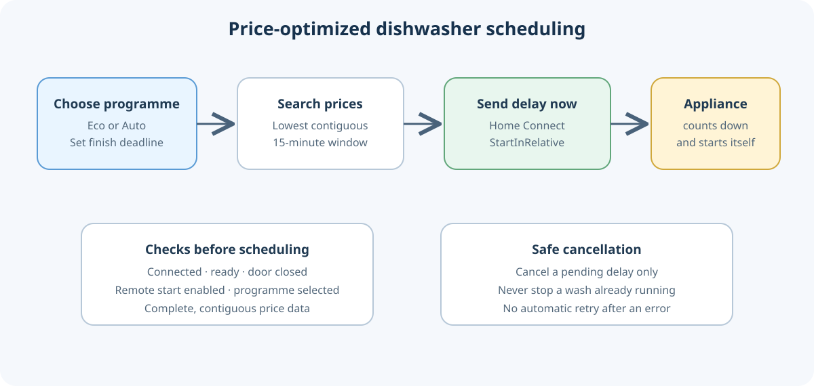

# Bosch dishwasher price-optimized scheduling for Home Assistant

This reusable example searches for the cheapest eligible start time before a chosen finish deadline, then sends the appliance's own delayed-start command immediately through the official Home Connect integration. Home Assistant does not wait idle until start time and then wake a power-saving appliance.

## Included files

- `helpers.yaml` — finish deadline, planned-start display, schedule marker, and find/cancel buttons
- `automations.yaml` — price search and immediate delay submission, safe cancellation, schedule tracking, and default-deadline rollover to 07:30
- `planner.jinja` — quarter-hour search template used by the planning automation
- `schedule-flow.svg` — process diagram

## Requirements and setup

1. Home Assistant with the official **Home Connect** integration and an appliance that supports remote start and `StartInRelative`.
2. A price entity with `raw_today` and `raw_tomorrow` timestamped 15-minute rows containing `start`, `end`, and numeric `value` in EUR/kWh. Adapt the entity ID and verify the units and row format.
3. Matching Home Connect entities and a device ID. This repository uses generic `dishwasher_*` placeholders; it contains no household identifiers.
4. A Home Connect program selector. The example recognizes Bosch program IDs `dishcare_dishwasher_program_eco_50` and `dishcare_dishwasher_program_auto_2`. Change these identifiers and duration mapping to fit the appliance's actual options.

Merge the helpers into your existing helper configuration without duplicating top-level sections. Merge the four automation entries into your automation configuration. Replace the generic entity IDs, price entity, and `REPLACE_WITH_HOME_CONNECT_DEVICE_ID`. Review the Home Connect service data against your installed integration's service schema. Default notification text is Finnish. Do not paste this example unchanged into a live installation.

## Scheduling model

- Eco is budgeted as 5 hours; Auto as 2.5 hours. Both receive a 30-minute finish buffer. These are estimates, not a finish-time guarantee.
- The search compares consecutive 15-minute slots and chooses the lowest sum of spot prices. It requires complete, contiguous, numeric data. Starts are limited to the appliance's approximate 24-hour delay limit; unpublished prices fail closed.
- The delay is rounded up to a whole minute and sent immediately using `home_connect.set_program_and_options`, `affects_to: active_program`, and Bosch's `b_s_h_common_option_start_in_relative` field. Bosch owns the countdown and starts the selected programme.
- It minimizes the spot-price window, not real appliance cost: load shape, household tariff details, and actual programme duration are not modeled. A constant per-kWh surcharge does not change the ranking; variable time-based fees would need to be added to slot prices.

## Safeguards

Scheduling requires the appliance connected, remote control and remote start enabled, door closed, power on, operation state `ready`, Eco or Auto selected, and no existing schedule marker. Cancel clears a pending delayed start only; it does not stop a running wash. Changing the finish deadline attempts to clear the old delay so a new search can be made. The HA schedule marker is separate from Home Connect's `delayedstart` state because cloud updates can lag. Errors do not trigger automatic retries.

Check configuration and inspect automation traces before relying on the adaptation. The source installation passed Home Assistant's configuration check and readback; this generic example still needs checking in the target installation.

## Entity mapping

| Example entity | Purpose |
| --- | --- |
| `sensor.electricity_price_quarter_hour` | 15-minute rows in `raw_today` / `raw_tomorrow` |
| `select.dishwasher_program` | selected programme |
| `binary_sensor.dishwasher_connectivity` | cloud connection |
| `binary_sensor.dishwasher_remote_control` | remote-control permission |
| `binary_sensor.dishwasher_remote_start` | remote-start permission |
| `sensor.dishwasher_door` | closed/locked state |
| `sensor.dishwasher_operation_state` | `ready`, `delayedstart`, `run`, and terminal states |
| `switch.dishwasher_power` | appliance power/ready state |
| `number.dishwasher_start_in_relative` | delay feedback in seconds |
| `button.dishwasher_stop_program` | clear pending delayed start |

No real household names, entity IDs, device IDs, addresses, or credentials are included.
